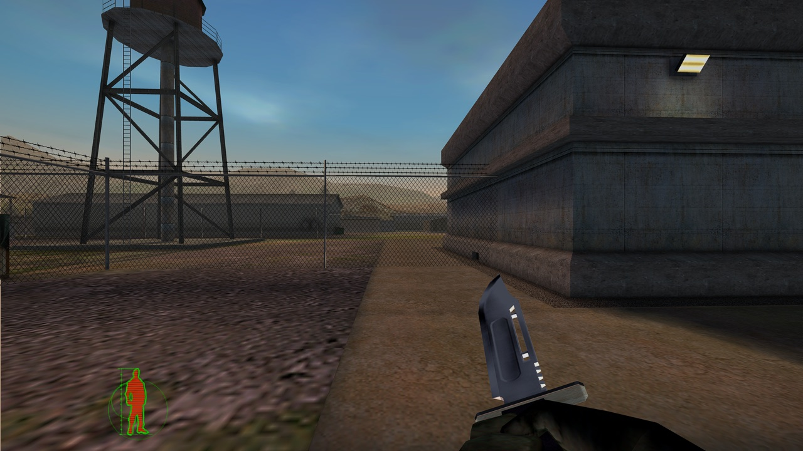
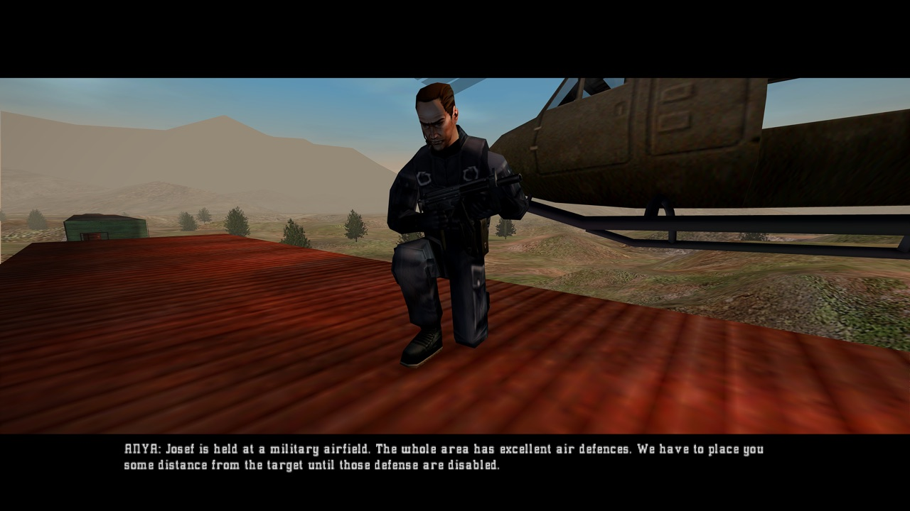
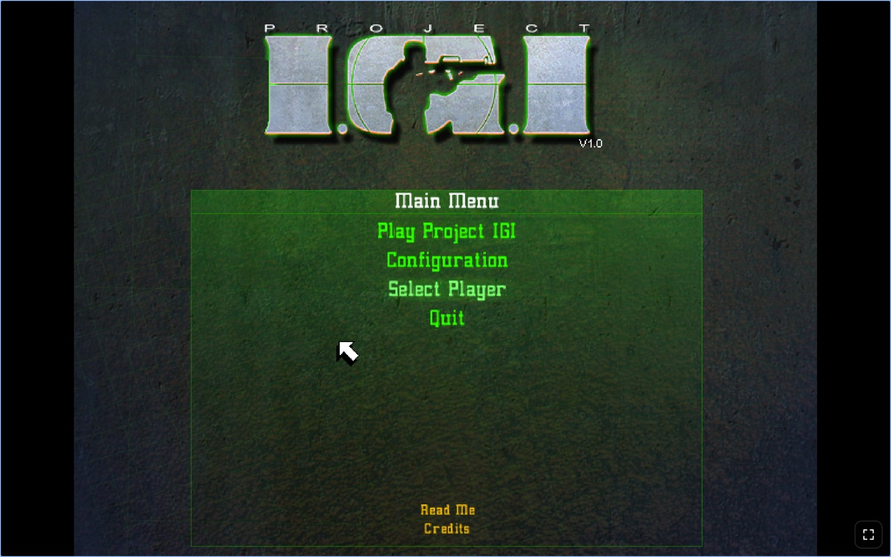
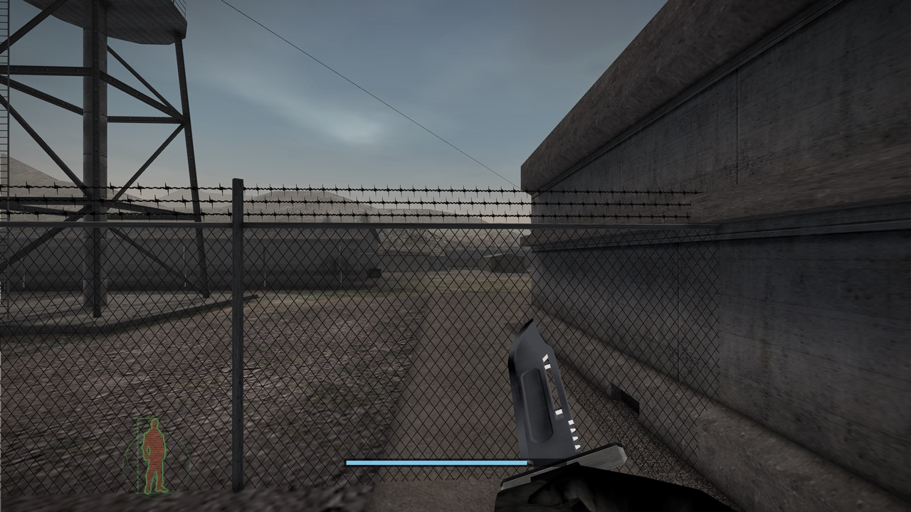

# Project I.G.I. in your browser and on your desktop

Play **Project I.G.I.: I'm Going In** (2000) in a web browser, or as an app on a Mac or a
Windows PC. It's the original game, translated from its Windows program into code that runs anywhere, with
no emulator. On top of it: widescreen, sharper graphics, controller support, aiming, a Max Payne-style dive
in slow motion, and cheat codes.

Free, with no ads. The game downloads once on the first launch (513 MB), with Square Enix's permission.

## Play

**In your browser:** [rishabhgupta3107.github.io/igi-browser](https://rishabhgupta3107.github.io/igi-browser/)
in a current Chrome, Edge or Safari on a computer (the game needs WebGPU).

**Or download the app:**

- **Mac with Apple chip (M1 or later):** [Project-IGI-Mac-Apple-Chip.zip](https://github.com/rishabhgupta3107/igi-browser/releases/latest/download/Project-IGI-Mac-Apple-Chip.zip)
- **Mac with Intel:** [Project-IGI-Mac-Intel.zip](https://github.com/rishabhgupta3107/igi-browser/releases/latest/download/Project-IGI-Mac-Intel.zip)
- **Windows (64-bit):** [Project-IGI-Windows.zip](https://github.com/rishabhgupta3107/igi-browser/releases/latest/download/Project-IGI-Windows.zip)

Not sure which Mac you have? Apple menu > **About This Mac**: "Chip: Apple M…" is an Apple chip, "Processor: …
Intel" is Intel.

Every version and what changed: [Releases](https://github.com/rishabhgupta3107/igi-browser/releases).

## Install

The apps aren't registered with Apple or Microsoft, so the first launch asks you to confirm.

**Mac**

1. Double-click the zip, then drag **Project IGI** into your Applications folder.
2. Double-click it. macOS says it can't check the app: click **Done**.
3. Open **System Settings > Privacy & Security**, scroll down to "Project IGI was blocked", and click
   **Open Anyway**, then **Open**. From then on it opens normally.

If macOS says the app "is damaged", open Terminal and run
`xattr -dr com.apple.quarantine "/Applications/Project IGI.app"`, then open it again.

**Windows**

1. Right-click the zip, **Extract All…**, and open the **Project IGI** folder.
2. Double-click **Project IGI.exe**. If "Windows protected your PC" appears, click **More info**, then
   **Run anyway**.

## First run

The first time, click **Download Project I.G.I.** and keep the internet on: it downloads once (513 MB, a minute
or two on a fast connection). If the download stops, open the page again and it carries on where it left off.
After that the game starts straight away, even offline.

Have your own copy? Choose the disc image (the `.iso` file, or drop it on the window), the disc itself, or the
folder you installed it to, instead of downloading.

Your saves stay on your computer, in that storage: the browser's saves are separate from the app's.

## Playing

| | Keyboard and mouse | Controller |
|---|---|---|
| Move | Arrow keys | Left stick |
| Look | Mouse | Right stick |
| Fire | Left button | RT |
| Aim (hold) | Right button | LT |
| Dive in slow motion | Middle or thumb button | LB |
| Next / previous weapon | Mouse wheel | Y |
| Jump | Numpad 0 | A |
| Crouch | Right Ctrl | B |
| Reload | Enter | X |
| Use / activate | Right Shift | RB |
| Binoculars | Space | D-pad right |
| Map | C | Back |
| Quick save / quick load | F5 / F9 | |
| Menu, skip a cutscene | Esc | Start |

Any controller works: Xbox, PlayStation, Switch Pro and most others. Plug it in and press a button.

**The dive:** while moving, press the dive button. You jump that way and everything slows down until just after
you land, while your aim stays quick. It uses the meter at the bottom of the screen, which refills by itself.

**Cheats:** type them during a mission, as in GTA (no need to pause). Type one again to turn it off.

| Code | Effect |
|---|---|
| `HEALTHY` | You take no damage |
| `BULLETS` | Infinite ammo and grenades |
| `NEVEREMPTY` | No reloading |
| `MATRIX` | More bullet time: **B** slows everything while the meter lasts, and every kill slows the game for a moment |
| `TERMINATE` | All of them |

## Updates

The website is always the latest version. The apps tell you when a new one is out (and **Help > Check for
Updates…**): download it and replace the old app. Your game files and saves stay where they are.

## Privacy

The website uses no cookies and doesn't track you. The apps only ask GitHub whether there's a newer version. Your
saves never leave your computer.

## Credits

Built on [cricket07-browser](https://github.com/Dhaiwat10/cricket07-browser) by Dhaiwat Pandya, which showed how
to translate a Windows game to run in a browser, and in the spirit of
[cricket07-desktop](https://github.com/udeshvirk/cricket07-desktop) by Udesh Kumar.

## Legal

Project I.G.I. © Square Enix. The game was made by Innerloop Studios and published by Eidos Interactive (now part
of Square Enix); its name is a trademark of its owner. This is an unofficial fan project: it is not sponsored or
endorsed by Square Enix, Innerloop Studios or Eidos Interactive, and it isn't an official Square Enix product or
partnership.
